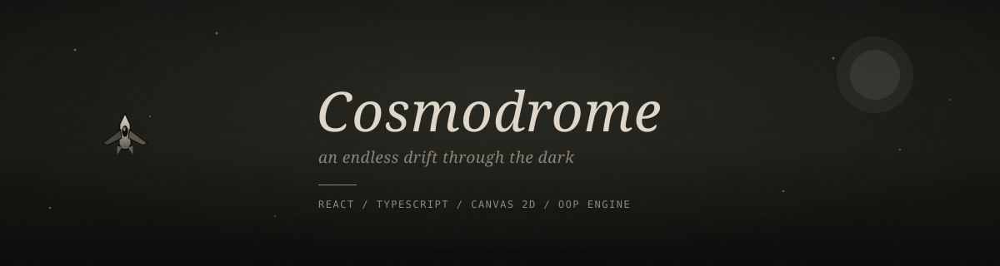
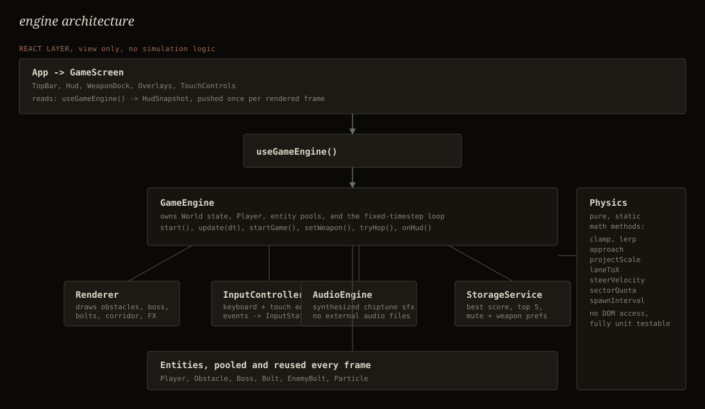
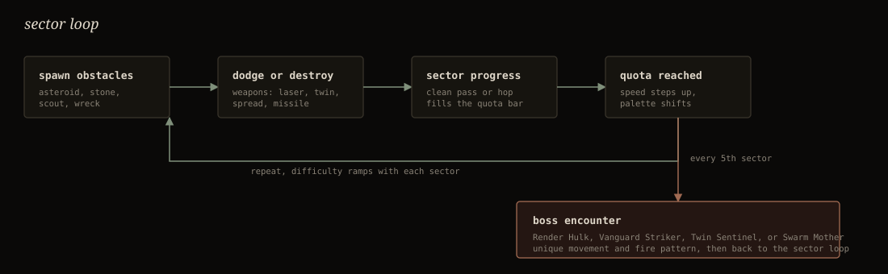

<div align="center">
  
</div>

<div align="center">


</div>

Cosmodrome is a nostalgic Enduro style endless space racer. Steer a lone starfighter through asteroid fields, drift around scouts and wrecks, hop over hazard stones, and take down a sector boss every fifth wave. It began life as a single-file vanilla JavaScript prototype and has been rebuilt here as a fully typed, object oriented React application with its own from-scratch canvas engine.

## Play

The live build deploys automatically to GitHub Pages on every push to `main`.

**[play cosmodrome &rarr;](https://hassanireza.github.io/cosmodrome/)**

## What changed in the migration

The original was a single `game.js` and `physics.js` pair driving a canvas directly, styled with one large stylesheet and no build step. This rebuild keeps the exact feel of that original but restructures it entirely:

- **Vanilla JS to TypeScript**, every entity, config value, and message between systems is now a typed interface. No more guessing what shape an object has mid-file.
- **One giant file to an object oriented engine**, `GameEngine`, `Renderer`, `InputController`, `AudioEngine`, and `StorageService` are now separate classes with a single job each, plus a shared `Physics` module of pure, static, unit testable math.
- **Direct DOM manipulation to React**, the HUD, overlays, weapon dock, and touch controls are declarative components that subscribe to one `HudSnapshot` pushed by the engine once per rendered frame. React never reaches into simulation internals.
- **No build step to Vite**, instant HMR in development, a type checked production build, and a GitHub Actions pipeline that deploys straight to Pages.
- **New features layered on top**, an extra life threshold, a mute toggle with persisted preference, a five slot local leaderboard, and touch controls for mobile play that were absent from the original.

## Architecture



The rule that keeps this codebase easy to extend: **React never simulates, and the engine never renders through the DOM.** `GameEngine.update(dt)` runs a fixed 60Hz timestep regardless of display refresh rate, and `Renderer` reads the resulting state to paint a single canvas frame. Everything React needs (score, lives, sector progress, boss health, toasts) travels through one `HudSnapshot` object.

## Gameplay loop



| System | Detail |
| --- | --- |
| Obstacles | Asteroids and hazard stones from sector one, raider scouts from sector two, armored wrecks from sector four |
| Weapons | Pulse laser, twin cannon, spread blaster, and homing missile, cycled with `Q` or the on-screen dock, each with its own heat curve |
| Hazard stones | Hop them with `space` during a short boost window for a combo multiplier, or clip them for a speed penalty |
| Sectors | Each sector raises a clean-pass quota; clearing it raises speed and shifts the color palette |
| Bosses | Every fifth sector, one of four archetypes (Render Hulk, Vanguard Striker, Twin Sentinel, Swarm Mother), each with distinct movement and fire patterns |
| Progression | Extra lives at score thresholds, a five slot local leaderboard, and a persisted best score |

## Controls

| Action | Keyboard | Touch |
| --- | --- | --- |
| Steer | Left / Right or A / D | left / right buttons |
| Thrust / brake | Up / Down or W / S | keyboard only |
| Hop a stone | space | up arrow button |
| Cycle weapon | Q | gear button |
| Select weapon directly | 1 through 4 | weapon dropdown |
| Pause | P or Esc | tap outside canvas |
| Confirm / launch | Enter | on-screen button |

## Project structure

```
src/
  engine/
    Physics.ts             pure static math, no DOM access
    config.ts              tunable constants, weapons, palettes, boss defs
    types.ts                shared type definitions
    GameEngine.ts          simulation state, fixed timestep loop, HUD pub/sub
    Renderer.ts             canvas drawing, reads engine state, mutates nothing
    InputController.ts     keyboard and touch to InputState
    AudioEngine.ts          synthesized sfx, no audio files
    StorageService.ts      localStorage best score, leaderboard, prefs
    entities/
      Player.ts Obstacle.ts Boss.ts Bolt.ts Particle.ts
  hooks/
    useGameEngine.ts        mounts the engine, exposes a live HudSnapshot
  components/
    GameScreen.tsx TopBar.tsx Hud.tsx WeaponDock.tsx
    Overlays.tsx TouchControls.tsx ShipIcon.tsx
  styles/
    game.css                design tokens, layout, texture
```

## Getting started

```bash
npm install
npm run dev
```

The dev server runs at `http://localhost:5173` with hot module reload.

```bash
npm run build      # type check with tsc, then production build to dist/
npm run preview    # serve the production build locally
npm run lint       # oxlint across the project
```

## Deployment

Pushing to `main` runs `.github/workflows/deploy.yml`, which type checks, builds with the correct base path for GitHub Pages, and publishes `dist/` via `actions/deploy-pages`. Pull requests run `.github/workflows/ci.yml` for lint and build verification only, without deploying.

To point this at your own fork, GitHub Pages picks up the repository name automatically through `VITE_BASE` in the workflow, so no manual base path edit is needed after a rename. For a custom domain, set `VITE_BASE=/` in the workflow and add a `CNAME` file under `public/`.

## Design system

The interface is built around a tactile, almost static aesthetic rather than a glowing arcade one: a near-monochrome bone and ash palette with a single oxidized-copper accent, a fine film grain layer over every surface, a condensation-style vignette on overlay screens instead of a hard blur, and a tall 135mm-portrait frame for the whole cabinet. Motion is kept deliberately shallow, transitions fade rather than bounce, and the boss alert pulses on a slow four second cycle instead of flashing.

## License

MIT
